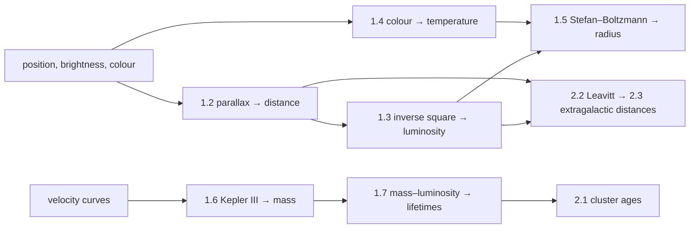

# Observatorium: design notes

November 2026. Built from the lecture slides, tutorials and homework of General Astronomy 1, lectures 1–5
(`../Source_Materials/`). Lectures 6 onward are planned at the end.

## 1. The idea

An observatory with a panoramic view of the real sky. Each chapter (one lecture) zooms to a different scale:
the sky, the solar system, the stars around us, clusters, the Milky Way, other galaxies. In each one you
retrace how people learned something: you start with the quantities they could measure, look at real data the
way they did, and deduce something new. What you deduce becomes a new measurable quantity, so the next
discovery opens. The data are real catalogues, not simulations.

## 2. How it teaches

**The inference chain is the game's progression.** At the start you can measure only what anyone can measure
from Earth: position, apparent brightness, colour, motion across the sky, period. Each mission adds one
relation, and the variables that relation makes possible unlock in every dataset's axis menus:

This is the request in the brief made literal: a plain sky chart of positions and brightnesses shows nothing,
and it is only when you switch to luminosity against temperature that the classes of stars appear (mission 1.3
is exactly that moment, with Gaia's 100 pc sample).

**Every mission is predict → observe → explain**, the same loop as the cGħ lab on the
`claude/physics-intuition-simulators-v6o4ag` branch: you commit to a prediction before seeing the data, do the
measurement yourself, and only then read the explanation. Asking students to predict before a demonstration
measurably improves what they take from it (Crouch, Fagen, Callan and Mazur 2004, *Am. J. Phys.* 72, 835).

**Every briefing answers three questions**, which the brief asked for: which variables we measure (symbol,
unit, how it is measured), which relation connects them, and what that lets us deduce. The explanation then
names the lecture section and homework question it supports.

**Real data keep the disagreements.** A simulation agrees with its own model; real data do not, and the
disagreements are where the physics is. The missions keep them and explain them instead of tuning them away:

| Mission | What the data say | Why |
|---|---|---|
| 1.4 | A blackbody reads the red dwarf 600 K too cold | Molecules in cool atmospheres make them redder than a blackbody |
| 2.1 | The simple turn-off clock makes M67 and NGC 6397 too young (2.6 and 4.8 Gyr against 4 and 13) | Turn-off stars have already brightened; metal-poor stars are brighter for their mass |
| 2.3 | Gaia Cepheids put the LMC at 52–53 kpc, against 49.6 kpc from eclipsing binaries | The metallicity dependence of the Leavitt law, still debated in the Hubble-constant tension |
| 4.2 | The globular-cluster swarm centres about 7 kpc away, not 8.2 | Clusters behind the bulge are harder to find |
| 4.3 | MOND fits NGC 3198 to χ²/N ≈ 10, a fitted dark halo to ≈ 1 | Both ideas are still argued about; the data say how well each does |

**A lecture before every exercise.** Each mission opens in the lecture hall: four or five short steps of
theory and reasoning, each with its equation, often a live explainer (the parallax geometry, two stars round
their centre of mass, a planet crossing a limb-darkened star, a lens forming two images), and a cue that turns
the dome to what is being discussed. Opening a mission swings the sky to its target at once, before the
prediction. After the exercise come one or two practice problems in the style of the homework, checked on the
spot, with worked solutions. The unit tests recompute every practice answer from the physics module.

**Real photographs when the subject is an object.** The sky has two looks. *Drawn* is the analysis view:
catalogue stars as points you can select. *Photo* is the observing view: ESO's all-sky panorama (S. Brunier,
CC BY 4.0) with close-ups from the Digitized Sky Survey (the photographic plates of the Palomar and UK Schmidt
telescopes), SDSS and the Legacy Surveys, reprojected live and blended in where they exist. Lecture cues switch
to photographs for nebulae, clusters and galaxies.

**Free exploration is always open.** Outside missions, any dataset can be put on any unlocked axes, selected,
and followed onto the sky. Teacher mode in the Notebook unlocks everything.

## 3. Curriculum map: lectures 1–5

| Lecture topics (from the slides) | Missions | Data | Homework |
|---|---|---|---|
| L1 §1.1 what astronomy is, history | 1.1 | Hipparcos (HYG) | HW1 Q1 |
| L1 §1.2–1.3 light, spectra, blackbodies | 1.4 | Gaia colours and temperatures | HW1 Q2–3 |
| L1 §1.4 temperature, distance, luminosity, radius, mass | 1.2, 1.3, 1.5, 1.6 | Gaia 100 pc; Gaia DR3 binaries | HW1 Q2, HW2 Q4 |
| L1 §1.5 HR diagram; §1.6 clusters | 1.3, 1.7, 1.8 | Gaia; Torres et al. 2010 | HW1 Q4, HW2 Q3 |
| L2 stellar evolution, populations | 2.1 | Gaia: Pleiades, Praesepe, M67, NGC 6397 | HW2 Q1, Q3; HW3 Q1 |
| L2 remnants: white dwarfs, pulsars, black holes | 1.5, 2.4 | Gaia; ATNF | HW2 Q1, Q2, Q5 |
| L2 variable stars: Cepheids | 2.2, 2.3 | OGLE-IV; Gaia DR3 | HW5 (distance ladder) |
| L3 exoplanets: transits, radial velocity, statistics | 3.1, 3.2 | Kepler; NASA Exoplanet Archive | HW4 Q1 |
| L3 history of lensing; microlensing | 3.3 | OGLE-IV EWS | HW3 Q2, HW4 Q2 |
| L4 solar system: asteroids, Kuiper belt | 4.1 | JPL SBDB | HW4 Q1 |
| L4 the Milky Way, the Great Debate | 4.2 | Harris catalogue | |
| L4 dark matter, MACHOs, MOND | 4.3 (and 3.3) | SPARC | HW5 |
| L5 galaxies: types, colours | 5.1 | SDSS + Galaxy Zoo | HW5 |
| L5 galaxy clusters, dark matter | 5.2 | SDSS (Coma) | |
| L5 scaling relations: Tully–Fisher, Faber–Jackson | 5.3 | SPARC | HW5 |

### Lecture coverage, reviewed against the slides (version 6)

A second pass through the slides of lectures 1–5 and the homework found topics that were taught but missing from
the observatory. They are now lecture steps, most with a photograph, a live chart of real data or a worked example
(119 steps, 27 figures, 27 worked examples, 36 practice problems):

| Topic (slides, homework) | Where it is now | Figure, chart or example |
|---|---|---|
| L1 telescopes: light grasp, resolution (HW1 Q1) | 1.1 *Telescopes* | Galileo and Jupiter's moons: photon counts, 20″ vs 3.5″, glare |
| L1 history: Aristarchus to Kepler, Galileo | 1.1 *From Aristarchus to Kepler* | why 87° gives 19 instead of 390 |
| L1 magnitudes, star counts | 1.1 *Magnitudes* | live histogram of 8,868 naked-eye stars (×3 per magnitude, not ×4) |
| L1 spectral lines, Bohr, Kirchhoff, Balmer | 1.4 *Lines* | live SDSS A0 spectrum with Rydberg-formula line positions; Hα worked out |
| L1 OBAFGKM, Cannon, Payne | 1.4 *The spectral sequence* | six live SDSS spectra, B to M |
| L1 Sirius B, white-dwarf size and density | 1.5 *Sirius B* | R = 5,800 km, 2.4×10⁹ kg m⁻³ |
| L1 visual binaries | 1.6 *Kepler's third law* | Sirius weighed: 3.1 M☉ |
| L2 mass transfer: Roche lobes, Algol, novae, X-ray binaries | 1.6 *When stars touch* | Eggleton's formula for q = 0.5 |
| L2 lifetimes (HW2 Q3) | 1.7 *Lifetimes* | 20 M☉: 5.6 Myr |
| L2 fusion: pp chain, CNO, solar neutrino problem | 2.1 *What makes stars shine* | the Sun's 10 Gyr vs 30 Myr by contraction |
| L2 endpoints: planetary nebulae, SN II and Ia, SN 1987A | 2.1 *How stars end* | Cat's Eye, SN 1987A; dome turns to the LMC |
| L2 black holes, Schwarzschild radius (HW2 Q5), EHT | 2.4 *Black holes* | M87*, Sgr A*; R_s = 29.5 km; 40 μas shadow |
| L2 pulsars as beacons | 2.4 *A lighthouse* | the Pioneer plaque's pulsar map |
| L4 gamma-ray bursts | 2.4 *Gamma-ray bursts* | live T₉₀ histogram of 4,430 Fermi bursts; isotropic energy |
| L3 direct imaging (slide example) | 3.2 *Taking a picture of a planet* | HR 8799; 0.25″ vs 0.05″ |
| L3 ISM, star formation, Jeans mass | 3.2 *Where stars are born* | Pillars of Creation; M_J ≈ 5 M☉ in a dense core |
| L3 IMF, Salpeter (HW3 Q1) | 3.2 *How many of each mass* | live mass histogram of 31,567 Gaia stars with Salpeter's slope |
| L3 protoplanetary discs | 3.2 *Where planets form* | HL Tau (ALMA) |
| L3 lensing history, strong lensing (HW4 Q2) | 3.3 *Gravity bends light*, *Rings, arcs and crosses* | 1919 eclipse plate; Cosmic Horseshoe (also on the dome), Einstein Cross; θ_E = 2.85″ |
| L4 the Sun, sunspots, the 11-year cycle | 4.1 *Our star*, *The 11-year cycle* | SDO image; live sunspot series since 1700 |
| L4 comets, Oort cloud | 4.1 *Comets and the Oort cloud* | P = 11 Myr at 50,000 AU |
| L4 Sgr A*, S2 | 4.2 *A black hole at the centre* | GRAVITY orbit; 4.2×10⁶ M☉ from Kepler's law |
| L4 dark-matter candidates: MACHOs, WIMPs | 4.3 *What could dark matter be?* | 72 colliding clusters (lensing vs X-rays) |
| L5 galaxy collisions | 5.1 *Galaxies collide* | the Antennae; star–star collision odds |
| L5 AGN, quasars, Eddington limit, one-sided jets | 5.1 *Active galactic nuclei* | M87's jet; 173 AU, 8×10⁸ M☉ |
| L5 luminosity function (Schechter) | 5.1 *How many galaxies…* | live M_r histogram of 14,000 SDSS galaxies with a fitted Schechter curve and the survey limit |
| L5 Local Group, catalogues, Great Attractor | 5.2 *Our neighbourhood* | all-sky markers |
| L5 cluster lensing (the lecturer's field) | 5.2 *Clusters as lenses* | Abell 370 (also on the dome), Webb's First Deep Field; θ_E ≈ 35″ |
| L5 a galaxy without dark matter | 5.2 *A galaxy without dark matter* | NGC 1052-DF2; virial mass |
| L5 top of the distance ladder: TRGB, masers, SNe Ia, fundamental plane | 5.3 *To the top of the ladder* | ladder explainer with the new rungs |
| L5 Olbers' paradox (HW5) | 5.3 *Why is the night sky dark?* | mean free path 10¹² ly |
| L5 Hubble–Lemaître law, cosmic clocks | 5.3 *How old is the Universe?* | 1/H₀ = 14 Gyr |

### Topics now in the lectures that could still become full missions

| Topic | Mission idea | Data (reachable from here unless noted) |
|---|---|---|
| L1 history: Kepler's laws | Recover the third law from planet and moon orbits | JPL Horizons / SBDB |
| L1 spectral lines, OBAFGKM | Classify real stellar spectra by their lines | SDSS stellar spectra (six shipped in `spectra.csv`) |
| L2 supernovae Ia vs II | Light-curve shapes and peak brightness | ZTF Bright Transient Survey (to test) |
| L2 black holes | Weigh Sgr A* from the orbit of S2 | Published orbital elements (GRAVITY 2019) |
| L3 initial mass function (HW3 Q1) | Count stars per mass bin in the 100 pc sample; fit Salpeter's slope | Gaia 100 pc (already shipped) |
| L3 habitable zone, snow line | Planets by insolation and temperature | NASA Exoplanet Archive (shipped) |
| L4 the Sun | The 11-year cycle in 270 years of sunspot counts | SILSO (shipped: `sunspots.csv`) |
| L4 gamma-ray bursts | Short and long bursts from the duration histogram | Fermi GBM burst catalogue (shipped: `grbs.csv`) |
| L4 Kuiper-belt occultations (HW4 Q1) | Event durations and detectable sizes | JPL SBDB (shipped) |
| L5 AGN, quasars | Broad lines and redshifts in quasar spectra | SDSS (reachable) |
| L5 Faber–Jackson, luminosity function | σ against luminosity; the Schechter fit | SDSS (shipped: `sigma` column) |

## 4. What already exists

From memory, not re-verified for this note; check before citing.

- **Guided labs with real or realistic data:** Project CLEA (Gettysburg College) simulates observing runs
  (Jupiter's moons, Hubble's law); the SDSS SkyServer education projects walk students through an HR diagram or a
  Hubble diagram with SDSS data; ESA and ESO publish exercise series built on real images and Gaia data.
- **Interactive simulations:** the Nebraska Astronomy Applet Project (NAAP) and PhET cover blackbodies, the HR
  diagram, eclipsing binaries and exoplanet detection, with simulated rather than catalogue data.
- **Exploring the sky and the data:** Stellarium, WorldWide Telescope, Aladin and Gaia Sky show real catalogues
  beautifully but do not guide an argument.
- **Citizen science:** Zooniverse (Galaxy Zoo, Planet Hunters) uses real data for classification, not inference.

What none of these does, as far as I know: follow one course's chain of inference across all scales with real
catalogues, where each deduction unlocks the next measurement. That chain is the point of this project.

Evidence for the method: predicting before observing (Crouch et al. 2004); interactive engagement and the
normalised gain used in *Check yourself* (Hake 1998, *Am. J. Phys.* 66, 64); design of interactive simulations
(Wieman, Adams and Perkins 2008, *Science* 322, 682); in astronomy specifically, the Lecture-Tutorials of Prather
and colleagues. For a stronger before/after test than the built-in quiz, the Light and Spectroscopy Concept
Inventory (Bardar et al. 2007) and the Astronomy Diagnostic Test are standard instruments.

## 5. Lectures 6 onward: the Universe level

The syllabus continues with observational cosmology, lensing and data science. Each source below answered from
this environment on 25 November 2026.

| Topic | Mission idea | Data |
|---|---|---|
| Expansion, the distance ladder's top | Build the Hubble diagram, then see acceleration | Pantheon+ supernovae (GitHub), Union2.1 (LBL) |
| The cosmic microwave background, acoustic peaks | Read the curvature off the first peak | Planck 2018 TT power spectrum (IRSA) |
| Cluster lensing (the lecturer's research) | Find arcs and measure an Einstein radius | CLASH and RELICS Hubble images (MAST) |
| Gravitational waves | Masses and distances of merging black holes | GWOSC event catalogue |
| Gamma-ray bursts, fast radio bursts | Two populations; dispersion as a distance | Fermi GBM (HEASARC); CHIME/FRB |
| Sunyaev–Zel'dovich effect | Clusters found by their shadow on the CMB | Planck PSZ2 catalogue (to test) |
| Statistics, large samples, machine learning | Classify galaxies or stars from many features | SDSS, Gaia (shipped) |

Add the slides for lectures 6+ to `Source_Materials/` and these become chapters 6–7 at the *Universe* rung of
the scale ladder.

## 6. Trying it with people

The cGħ lab's evaluation guide applies unchanged: take *Check yourself* before and after, do five or six
missions thinking aloud, and copy the results (scores, normalised gain, and each mission's prediction). The
missions where almost everyone predicts wrong and stays wrong in the after-quiz are the ones to rewrite.
